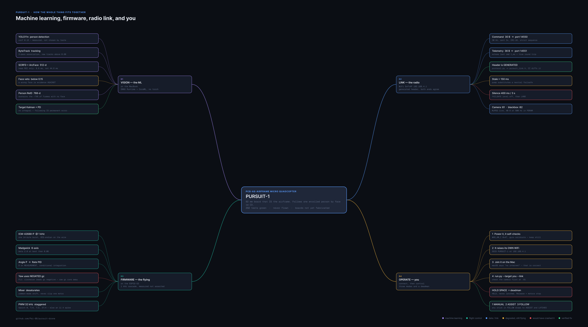
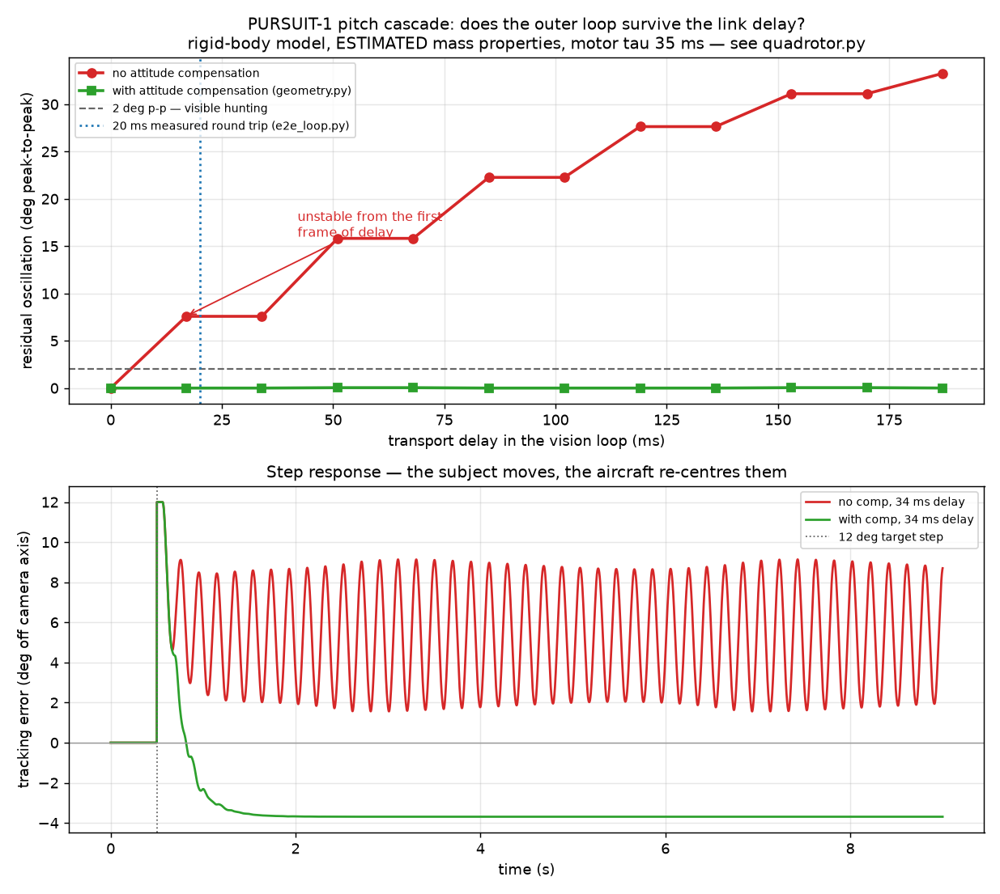
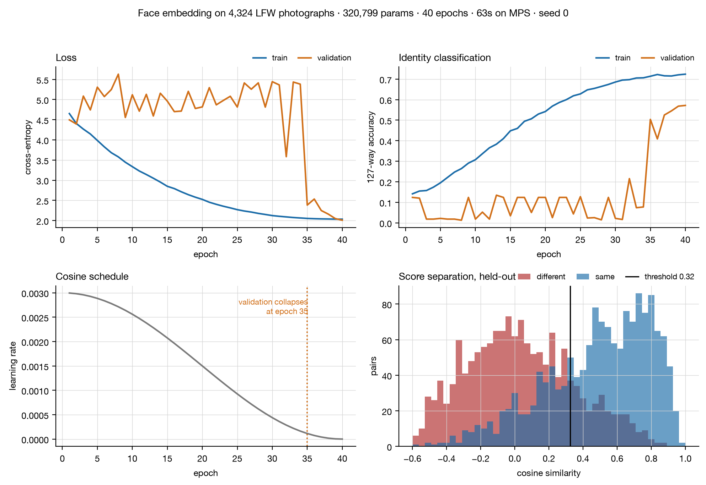
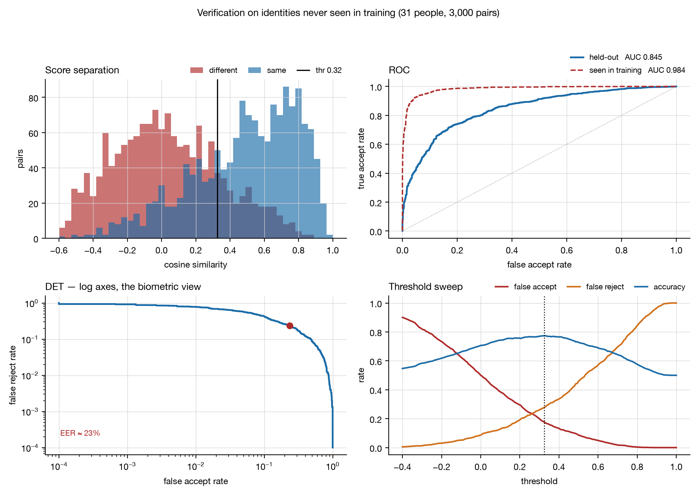
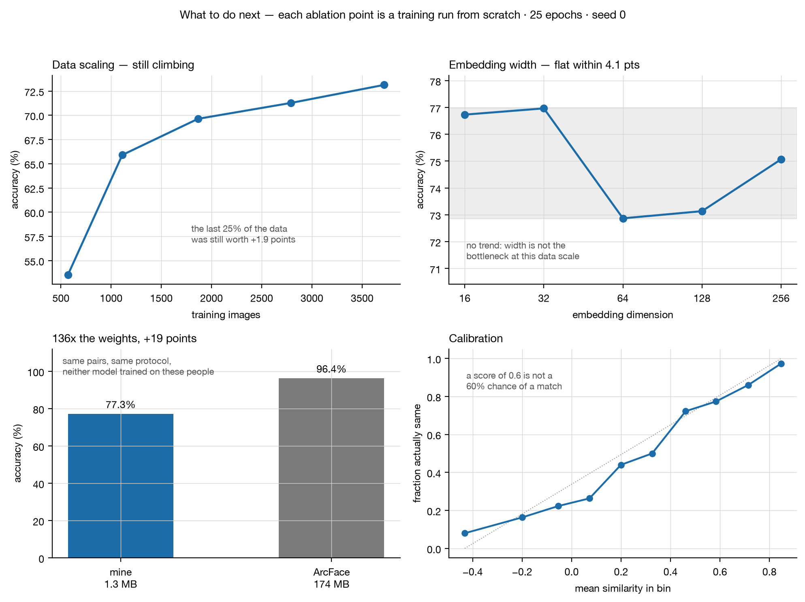

# PURSUIT-1

**A 92 mm quadcopter whose printed circuit board is its own airframe, that
follows one specific enrolled person by face re-identification.**

[](https://github.com/Pai-88/pursuit-drone/actions/workflows/ci.yml)
&nbsp;·&nbsp; 207 Python + 85 native C++ tests
&nbsp;·&nbsp; MIT

[](docs/media/pursuit_mindmap.png)

<sub>Click for full size. Two halves — the machine learning on a laptop, the
flight control on an ESP32-S3 — joined by a 30-byte packet and nothing else.
The red nodes are the two defects that would have destroyed the aircraft.</sub>

There is no separate frame. The 2-layer FR4 board *is* the structure — motors
clamp into rings routed through the arms — and it is generated from a canonical
Python netlist rather than drawn by hand. The flight firmware is written from
the IMU registers up. The perception stack runs off-board on ONNX Runtime and
speaks to the aircraft over a wire protocol that is generated from one source
so the two ends cannot drift apart.

> ### Status — read this first
>
> **The aircraft has never flown.** The boards are not yet fabricated, and the
> PID gains are scaled from typical brushed-whoop values, not tuned on this
> airframe.
>
> What *is* done and checked: the PCB passes a seven-gate executable release
> check and is fabrication-ready; the firmware builds for the ESP32-S3 and its
> safety-critical logic passes 85 host tests; the vision pipeline runs at 25 fps
> on a laptop webcam and holds a lock on an enrolled person; the two ends have
> been shown to agree byte-for-byte; and the control cascade has been analysed
> against a plant model. Everything in this README that is a measurement says
> so, and everything that is an estimate says that instead.

---

## The one result worth your time

The outer control loop is closed *through the airframe*: pitching to chase a
subject moves the camera, which moves where that subject appears in frame. That
feedback path has a DC gain of

```
VIS_PITCH_KP / VFOV_HALF_DEG  =  34 / 26  =  1.31
```

Above unity — so correcting a subject who is 12 degrees high commands 15.7
degrees of pitch and moves them *further* than the error that prompted it. Add
any link delay and it oscillates.



| transport delay | without attitude compensation | with it |
|---|---|---|
| 0 ms | settled | settled |
| 17 ms — **one frame** | 7.6 deg p-p, growing | settled |
| 102 ms | 22.3 deg p-p | settled |
| 187 ms | 33.3 deg p-p | settled |
| **boundary** | **~17 ms** | **> 200 ms** |

The measured round trip is ~20 ms. Uncompensated, that is already past the
boundary. The attitude compensation in `vision/pursuit/geometry.py` had
previously been justified by argument alone; it now has a number, and the number
says it is not a refinement of the design but the thing that makes it work.

Reproduce it, and read the caveats — the mass properties are estimates and the
motor time constant is a literature value:

```bash
python sim/flight/lag_sweep.py
```

Details and limitations: [`sim/flight/README.md`](sim/flight/README.md).

---

## Check it yourself

Nothing below needs an aircraft, a board, or a camera.

```bash
# 1. the off-board perception, control, lock and protocol stack
python -m pytest vision/tests -q          # 175 pass with no models downloaded

# 2. the flight-critical firmware logic, compiled and run on the host
cd firmware && pio test -e native         # 85 tests

# 3. the closed-loop plant model and the stability result above
python -m pytest sim/flight -q && python sim/flight/lag_sweep.py
```

For the full vision pipeline, fetch the ~295 MB of weights first — they are not
in the repository, and two of them exceed GitHub's file-size limit:

```bash
python vision/fetch_models.py && python -m pytest vision/tests -q   # 193 pass
```

Then run it live on a webcam, with no drone involved at all:

```bash
python vision/enroll.py --name you --height 1.75
python vision/run.py --target you
```

---

## How it fits together

```
laptop                                              aircraft (ESP32-S3)
------                                              -------------------
camera / MJPEG over WiFi
  -> YOLO11n person detection                       IMU (ICM-42688-P) 1 kHz
  -> ByteTrack multi-object tracking                  -> Madgwick 6-axis filter
  -> SCRFD face detection (head ROI)                  -> angle P
  -> ArcFace 512-d embedding                          -> rate PID
  -> person ReID 768-d                                -> mixer, desaturating
  -> 4-state lock machine                             -> phase-staggered PWM
  -> PD visual servo                                VL53L1X altitude hold 30 Hz
  -> CRC-16 UDP, 30 Hz, 3x redundant  ------------>  watchdog, arming interlocks
                                     <------------  telemetry, 20 Hz
```

There is a fuller version of this — every stage, every threshold, every failure
guard — as a single sheet: [**architecture poster**](docs/media/pursuit_architecture.png),
or by section: [vision](docs/media/arch_01_vision.png) ·
[link](docs/media/arch_02_link.png) · [firmware](docs/media/arch_03_firmware.png) ·
[operating it](docs/media/arch_04_operate.png).

**Identity is two signals with different jobs.** The face *acquires* and
re-confirms, and is strict. Body ReID only *sustains*. The appearance model
updates only on face-confirmed frames — unconditioned, it drifts onto a stranger
within a minute. And a readable face scoring below 0.15 is treated as evidence
*against*, not as absence of evidence: without that veto, an identity swap
between two people in similar clothing was sustained by appearance alone,
indefinitely.

**Verified on two real people, 2026-08-10.** 400 frames on a live webcam with a
second person moving through frame, crossing in front, and remaining after the
target left: **locked 98%** of frames (391/400, 5 coasting, 4 searching), never
lost, and the lock never transferred. Face confidence dips to 0.73 during
occlusion and recovers to 0.95 — body re-ID sustaining exactly as intended.
That test had never been run until then, and it mattered: the second identity
previously in the gallery turned out to be the same person as the first, so
every earlier claim of discrimination had been resting on nothing.

**The wire protocol is generated, not duplicated.** `vision/gen_protocol_header.py`
emits `firmware/include/pursuit_link.h` from `vision/pursuit/protocol.py`, and CI
regenerates and diffs it on every push. A cross-language test parses real
Python-emitted bytes through the real firmware code path — because matching
struct *sizes* prove nothing: field order can differ while sizes agree,
endianness can be right in one direction only, and a CRC computed over a
different byte range is self-consistent within each language and rejects
everything across the link. All three of those pass both test suites separately
and fail on the first flight.

---

## The machine learning, and what it cost to skip it

The identity layer runs ArcFace — 174 MB somebody else trained. That is the
right call, and it was a call nobody had put a number on. So I trained one from
scratch on real data and benchmarked both on the same protocol.

**The data is real.** Labeled Faces in the Wild: 4,324
photographs of 158 people, from news wire images. Not
synthetic, not augmented from a handful of faces.

**The protocol is the part that matters.** The split is by IDENTITY, not by
image — 127 people to train on,
31 held out and never seen. Splitting by image
instead, which is what a flat `train_test_split` does, leaves the same faces on
both sides:

| | AUC | accuracy |
|---|---|---|
| **held-out identities** | 0.845 | **77.3%** |
| identities seen in training | 0.984 | 93.9% |

16.6 points of inflation, measured rather than asserted.



**Against the pretrained model, on identical pairs:** ArcFace scores
96.4%, mine 77.3%. So
136x the weights buys
19 points. ArcFace is handicapped here
by unaligned 62x47 crops — its published LFW figure is 99.8% — and the figure
says so.



**The two plots that change a decision.** Accuracy is still climbing at 100% of
the data (53.5% at 570 images →
73.1% at 3720), so more data is the highest-value
next move. Embedding width, sweeping 16 to 256, is flat inside run-to-run noise
— so the 1.283 MB model is not width-limited, and on a 66 g aircraft
the narrow version is free.



Every point is a training run from scratch. `ml/runs/` records each epoch, the
split and the model, so the figures are traceable:

```bash
ml/.venv/bin/python ml/train_face_embed.py   # ~60 s on an M-series GPU
ml/.venv/bin/python ml/ablations.py
ml/.venv/bin/python ml/plot_all.py
```

Torch needs its own Python 3.11 environment — the vision stack runs 3.14, which
has no torch wheels. That is why `ml/` is separate rather than inside `vision/`.

---

## Repository layout

```
hardware/       KiCad 10 project — pursuit.kicad_pcb, .kicad_sch, pursuit.pretty/
scripts/        the board is GENERATED, not drawn
                  design.py       canonical netlist — the single source of truth
                  gen_pcb.py      board generator (pcbnew API)
                  gen_sch.py      schematic generator
                  routes.py       explicit routing tables
                  preflight.py    7-gate order gate — must exit 0 before fab
                  release.py      gerbers, drill, renders, PDF, zip, MANIFEST
gerbers/        fabrication output + the three JLCPCB upload files

firmware/       ESP32-S3, PlatformIO. Two environments on purpose:
                  src/            madgwick, pid, mixer, motors, icm42688,
                                  alt_hold, rangefinder, blackbox, loopstats,
                                  benchtest, flight_state, battery, frame.h
                  test/           85 host tests — everything safety-critical is
                                  written free of Arduino headers so it runs
                                  on a laptop
                  include/        config.h pin map, generated pursuit_link.h

vision/         off-board perception and control, ONNX Runtime + CoreML
                  pursuit/        detector, bytetrack, face, reid, gallery,
                                  lock, control, geometry, arbiter, pilot,
                                  protocol, link, pipeline
                  tests/          177 tests
                  tools/          e2e_loop.py, degradation_sweep.py
                  sim_drone.py    a fake aircraft for loopback testing

ml/             training, on real data, in its own Python 3.11 venv
                  train_face_embed.py  LFW, split by identity not by image
                  ablations.py         data scaling + embedding width sweeps
                  plot_all.py          twelve plots, four to a figure
                  runs/                history.json, ablations.json, eval.npz

sim/flight/     closed-loop plant model and the stability sweep above
docs/           DESIGN.md, VERIFICATION.md, assembly SVGs, vendor/SOURCES.md
```

---

## Things that were wrong, and how they were caught

Kept because the interesting part of a project is where it was wrong, and
because each of these was found by a different kind of check.

- **Yaw feedback was sign-inverted — guaranteed runaway on the first hover.**
  The body frame is FLU, so a clockwise yaw reads gyro-Z *negative*; the headers
  described it as "X forward, Y right, Z up", which is left-handed and was
  simply a lie. Fixed in `firmware/src/frame.h`. The closed-loop test converges
  with the fix and provably diverges without it.
- **An accelerometer measures specific force.** Level and upright it reads
  **+1g on +Z** — the table pushes up — not −1g. Inverted, the estimate is
  exactly wrong rather than obviously broken, and the aircraft would "correct" a
  30 degree bank by rolling to 60. Caught by a host test, not by reading.
- **A clock-epoch bug that every unit test passed.** `cmd.t_ms` was stamped when
  the packet was built, not when it was sent, so the round-trip computed against
  the echo compared two unrelated epochs, fell outside the plausibility window,
  and was silently discarded — leaving lead compensation pinned at its 150 ms
  guess against a true 20 ms. Only `vision/tools/e2e_loop.py`, which runs the
  whole chain under 10% packet loss and 5% corruption, could see it.
- **Adding redundancy exposed a latent sequence bug.** `is_newer(5, 5)` returned
  true, so an exact duplicate was accepted and re-applied. Harmless while each
  command was sent once; live the moment the link began sending three copies.
- **The camera was configured backwards.** `degradation_sweep.py` measured that
  YOLO tolerates sensor noise (2 people found at gain 4x) and collapses under
  motion blur (2 people at 5 px, **zero** at 15 px). An earlier version capped
  gain at 4x to avoid noise — exactly the wrong priority for an airframe that
  yaws. It now prefers a dark, noisy, short-exposure frame.
- **`LOOP_HZ 1000` was an intention, not a measurement.** Nothing sampled the
  real period, and the statistic the loop did keep — iterations per second — is
  precisely the one a stall hides inside. `firmware/src/loopstats.h` keeps the
  distribution instead.

---

## Ordering (JLCPCB)

Run `scripts/preflight.py` first — it is a hard gate over the release
artefacts and exits non-zero if anything is stale or inconsistent.

Upload three files: `gerbers/PURSUIT-1_JLCPCB.zip` (fabrication),
`gerbers/JLCPCB_BOM.csv` and `gerbers/JLCPCB_CPL.csv` (assembly).
2 layers, 1.6mm FR4, 1oz, any colour, quantity 5.

**Surface finish: ENIG, not HASL.** Everything on the board is 0603/0805/
SMA/SOT-23 and would be happy on HASL, except U2 — a bottom-terminated
LGA-14 on 0.5mm pitch with no visible fillets. HASL leaves a domed,
non-coplanar surface, which on that one part is the classic cause of opens
you cannot see without an X-ray. It is roughly +$20-25 on this order and
changes nothing in the files.

For assembly: **Top side only**, **PCBA quantity 2**, Economic, and set
**Confirm Parts Placement = Yes** — the SOT-23 rotation convention is not
settled between the published community databases, so the placement render
is the only reliable check. The CPL carries KiCad's own rotation with no
correction applied; do not pre-apply one from a community table, read it
off their render. Work through `gerbers/ORIENTATION_CHECK.csv` one
designator at a time against that render before paying.

Expect a DFM note about **component-to-board-edge distance**. JLCPCB ask for
2.5mm and this board cannot give it: it is an X-frame with 12mm arms, so the
SMA flybacks sit ~0.7mm from an arm edge and LED1/LED2 ~0.5mm. That is
inherent to a PCB-as-airframe, not a mistake — but it may draw an engineering
query or an added rail/tab charge. If they decline to assemble it, the
fallback is bare boards plus the hand-build list in `gerbers/BOM.csv`.

Cost is dominated by the IMU: C1850418 is **~$17 each**, Extended (so a
per-line feeder fee), and it forces mandatory X-ray inspection because the
LGA-14 pads are hidden. C4, and possibly LED1, are the other Extended lines
— check the **Extended components fee** line in your cart and divide by the
per-line rate to see how many they actually counted. The BOM is now **13
lines / 29 placements** (C6 and C7 are pads-only), so re-quote rather than
reusing an older cart total. Budget
**~GBP 75-90** all in for 5 boards with 2 assembled, once ENIG, the X-ray and
two extended-part fees are counted; the bare PCB itself is a few pounds of
that. Set the **order-number placement** option explicitly rather than
letting JLCPCB drop their code anywhere on the silk.

## Build order

Reference designators are on the Fab layer, not silkscreen (they would
collide at 0603 pitch), so **open `docs/assembly_top.svg` while placing
parts** — it shows every refdes in position.

1. **Top-side SMD arrives already assembled** if you ordered PCBA (Q1-Q4,
   D1-D4, all top R/C, both LEDs, and U2 the IMU). Only hand-solder these
   if you bought bare boards — and note U2 is an LGA-14 with hidden pads
   that needs paste + hotplate/hot-air, 260°C max, never ultrasonic-clean.
2. **Belly SMD** (yours either way): C1 and C10-C13. All iron-solderable.
3. **THT**: XIAO headers (module removable), JST J1, ToF right-angle header.
   Solder two short wires from the XIAO's underside BAT+/BAT- pads to
   the J4 pads just behind the module (enables USB-C charging of the pack).
4. **Motors**: the belly silk marks each position (M1-M4) *and its
   required rotation* (M1/M4 CW, M2/M3 CCW — diagonal pairs match, which is
   the standard X-quad pattern). Fit motors to match, and make your firmware
   mix agree with those labels. To reverse a brushed motor, swap its two
   wires. The 8.70mm rings are a deliberate CLEARANCE fit, not a press
   fit — at JLCPCB's +/-0.2mm routing tolerance a true interference fit
   either cracks the ring or disappears entirely. Seat each motor square
   to the board (the clearance fit gives no alignment datum of its own),
   then zip-tie through the flanking holes over the can; add a dab of CA
   if it still shifts. M1 FL / M2 FR / M3 RL / M4 RR, wires to the MT pads
   (+ marked). Buy 2x CW + 2x CCW motors and fit counter-rotating pairs
   diagonally.
5. **Camera**: bend the FPC ~90° so the lens faces forward over the front
   edge; secure with a foam wedge or a printed clip that grips the board's
   front edge. (There are deliberately no screw holes — see BOM.)
   Don't re-bend the flex repeatedly. Attach the U.FL antenna and tape the
   whip along a rear arm (away from the marked ANT zone under the module).
6. **Battery**: velcro pad on the belly front + zip-tie/strap through the
   two 3.2mm holes. Balance so the CG sits at the geometric centre.

## Two hard requirements the board places on the firmware

Both are **implemented** — this section records why they exist, because both
are the kind of thing that is invisible until an aircraft falls out of the air.

SPICE simulation of the drive stage (see VERIFICATION.md §6) shows the pack
rail sagging to **3.61 V at four-motor full throttle** with an optimistic
60 mΩ source model — a real 450 mAh 1S cell is worse. The XIAO's 3V3 buck
drops out around 3.5 V input, which would brown out the flight controller
mid-air. The board carries the sensor needed to prevent it: the VBAT_SENSE
divider on D2.

→ `firmware/src/battery.cpp`. It keeps **two** filters deliberately: a 20 ms
fast one for the sag limiter, which has to react *during* a burst or the buck
browns out anyway, and a 2 s slow one for the land decision, because otherwise
a normal throttle burst reads as a flat pack and the aircraft lands itself. The
throttle floor is 0.35 — cutting to zero turns a descent into a fall, and a
falling aircraft draws no current, so the voltage recovers and it oscillates
its way down.

Second requirement: **stagger the four LEDC PWM channels by 90°**
(hpoint = 0, T/4, T/2, 3T/4). By default all four channels on a timer rise on
the same edge, turning four 2.75 A steps into one synchronised 11 A step on the
pack. Staggering cuts peak rail current to ~2.75 A and roughly halves C1's
ripple heating.

→ `firmware/src/motors.cpp`, and it must use `ledc_set_duty_with_hpoint()` from
the IDF driver rather than Arduino's `ledcWrite()`: plain `ledc_set_duty()`
resets hpoint to 0 and silently un-staggers everything on the first write.

The same simulation confirms the safety property the design depends on:
the gates cannot reach the AO3400A's 0.65 V threshold at reset.

R5-R8 are **1 kΩ, not 10 kΩ**, and the reason matters because an earlier
revision of this file got it wrong. It claimed the XIAO Sense expansion board
pulls D8 up through 4.7 kΩ; that came from a forum post. Seeed's actual
schematic (`XIAO_ESP32S3_ExpBoard_v1.0_SCH.pdf`, read at 900 dpi to resolve
the junction dots) puts the three 4.7 kΩ pull-ups on **D9/MISO**, **D10/MOSI**
and **SD_CS** — never on D8/SCK, which carries only a 22 Ω series link and an
ESD clamp. So M4_PWM floats at reset exactly like M1-M3.

1 kΩ is kept anyway, for a reason that survives checking: it bounds the gate
against an *unexpected* pull-up. The ESP32-S3's own internal pull-up is
~45 kΩ, and at 10 kΩ that fault would put a gate at 0.60 V — within 50 mV of
the AO3400A's 0.65 V minimum threshold. At 1 kΩ the same fault gives 72 mV.
It also discharges the gate about ten times faster when a pin goes high-Z. The
cost is 3.00 V of gate drive instead of 3.28 V, still above the 2.5 V at which
Rds(on) is specified.

The two pull-ups that *do* reach this board land on D9 (IMU_INT — harmless,
and it usefully serves the ICM-42688-P's open-drain INT1) and D10 (LED_CTRL —
0.29 mA of LED glow at reset).

## First power-up — read this or release the smoke

1. **Verify battery polarity with a multimeter against the `+` on the top
   silk beside J1's left pad before ever plugging in.** JST-PH polarity is
   NOT standardised; roughly half of cheap packs are wired the other way.
   Reversed = every FET plus the XIAO die instantly.
   The same applies to C1 when you fit it: the belly silk reads `+ C1`
   beside its positive pad, and the footprint's silk bar is at that same
   end. C1 is a polymer/tantalum bulk cap straight across an unfused pack —
   backwards, it vents.
2. Optional: cut J3 on the Sense expansion board to drop the SD pull-ups on
   D9/D10. Not required — neither pin drives a motor. Leave it alone unless
   you want the IMU interrupt line clean, and note you lose the microSD slot.
3. Props OFF. Power via USB-C first: flash a firmware stub, check 3V3,
   scan I2C (expect 0x68 IMU, 0x29 ToF), read the battery ADC.
4. First LiPo plug-in through a fused/current-limited lead if you have one.
5. Motor test one at a time at low duty; verify spin directions.

## Design compromises (known, deliberate)

- Debug UART header dropped — use the XIAO's USB-C serial; D6/D7 remain
  free and reachable on the module's castellated pads.
- One 0.15mm trace runs under the IMU body (AP_CS→VDDIO tie) — against
  TDK's strictest layout note but standard practice at hobby scale.
- One I2C bus shared by IMU (1kHz reads) + ToF (30Hz) ≈ 40-50% bus
  utilisation at 400kHz — fine; move the IMU to SPI in a respin if you ever
  need 8kHz gyro ODR.
- JST-PH is rated 2A continuous vs ~11A full-throttle bursts — accepted
  whoop-class practice; solder a 20AWG pigtail to the J5 pads for hard use.
- The 1.6mm board is ~3g heavier than 1.2mm — chosen for first-spin crash
  survival. Arms are 12mm wide for the same reason (and to give the VBAT
  pour a clear channel past the motor traces).
- Motors are a **clearance** fit in 8.70mm holes, not a press fit: at
  JLCPCB's ±0.2mm routing tolerance a true interference fit either cracks
  the ring or vanishes entirely. Retention is the zip ties (+ a dab of CA).
- No expansion header: its 3V3 trunk had to wrap the whole right side and
  blocked the motor fan-out. J2 (ToF) already brings out 3V3 and GND.
- Both orientation LEDs hang off one GPIO (LED_CTRL), so they are always on
  or off together — nose vs tail is told by colour (yellow / red), never by
  blink pattern. D6/D7 are free if a respin wants them separated.
- Ten placed parts sit closer to a routed edge than JLCPCB's 2.5mm PCBA
  guideline (worst: LED1/LED2 ~0.5mm, D1-D4 ~0.7mm). Unavoidable on 12mm
  arms; see the ordering section.
- **C6 and C7 are pads only — deliberately not fitted.** The XIAO's 3V3 comes
  from U3, an SGM6029C 4 MHz buck whose datasheet gives an *effective* output
  capacitance range of **5-10 µF**, and the module already carries 9.4 µF
  nominal of its own. Fitting C6 (22 µF) and C7 (100 µF) put roughly 50-64 µF
  effective on that node — five to six times the specified window, on the rail
  that powers the flight controller. C2/C3/C4 stay fitted; they are IMU-local
  and add only ~1.9 µF. If bring-up shows the 3V3 rail actually sagging, hand-
  solder C6 and/or C7 then: adding to a bare pad takes five minutes, removing
  a reflowed 1206 sitting 7.3 mm from a 0.5 mm-pitch LGA does not.

## Mass / thrust budget (estimates — weigh as you build)

frame ~13g + XIAO+camera ~6g + motors 21g + props 2g + IMU/passives/
connectors ~4g + battery 18g (650mAh) + wires ~2g ≈ **66g AUW**.

Thrust is ~140g nominal, but derate it for the pack sag this board's own
SPICE model predicts and the usable figure is ~102g — so **T:W ≈ 1.6, not
2.3**. Hover sits near 60-65% throttle. That is flyable but not sprightly:
gust rejection is limited and there is no payload margin worth speaking of.

## UK legal

Camera drone: CAA **operator ID** (£11/yr, label the airframe) + free flyer
ID test, even sub-250g. Fly line-of-sight; person-following demos with a
consenting friend, indoors or private open space at walking pace.
