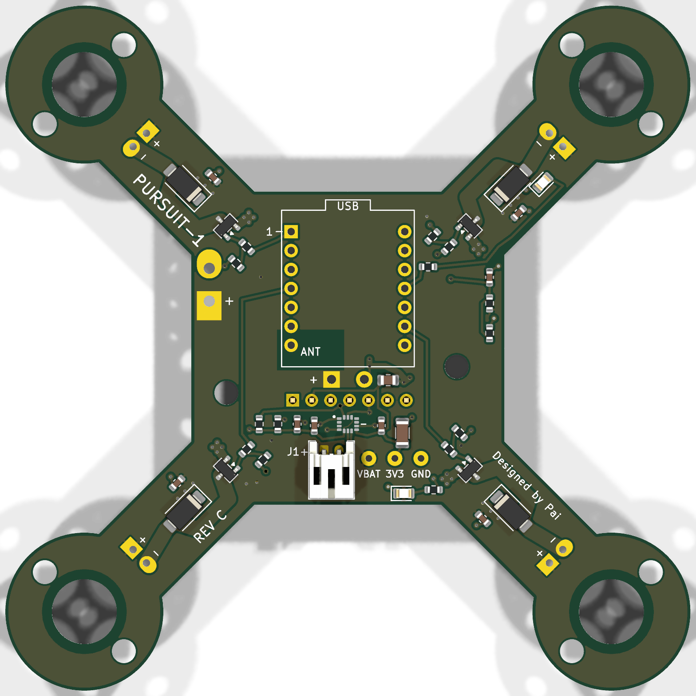
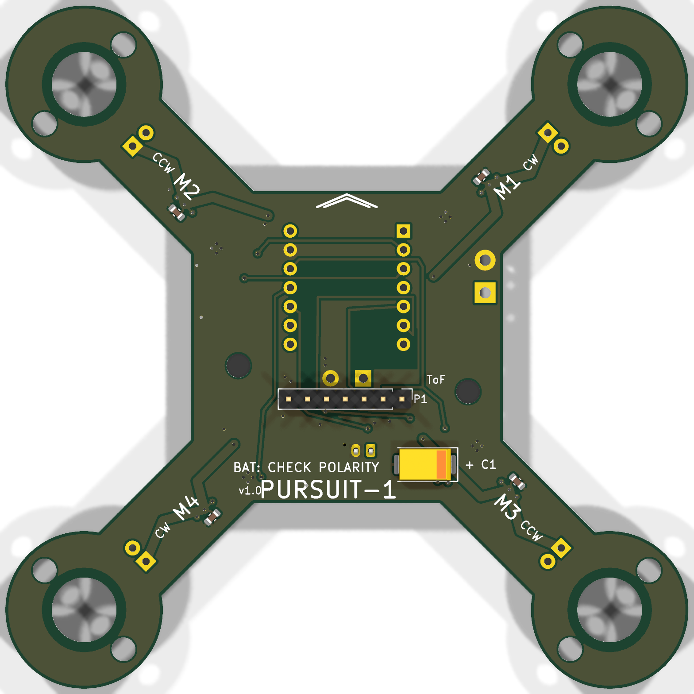

# PURSUIT-1

A 92 mm quadcopter whose circuit board is its own airframe, built to follow one enrolled person using face and body re-identification.

[](https://github.com/Pai-88/pursuit-drone/actions/workflows/ci.yml) · MIT licence

<p align="center">
  
  
</p>
<p align="center"><sub>Rev C board, top and bottom (KiCad renders)</sub></p>

There is no separate frame. The 4-layer FR4 board is the structure, and the motors clamp into rings at the ends of its arms. The board is generated from a Python netlist rather than drawn by hand. The ESP32-S3 flight firmware is written from the IMU registers up. Person detection and identity run off-board on a laptop (ONNX Runtime), which sends attitude and throttle setpoints to the aircraft over WiFi using a wire protocol generated from a single source file.

## Status

**It has not flown yet.**

| | |
|---|---|
| Rev A board | Fabricated and SMD-assembled by JLCPCB, hand-finished, brought up on the bench in August 2026 |
| Rev C board | Released for fabrication: 4 layers, thermal relief on the hand-soldered pads that caused every rev A fault, `preflight.py` 0 failures and 0 warnings |
| Firmware | Builds for the ESP32-S3; 128 host tests cover the flight-critical logic |
| Vision | Holds a lock on an enrolled person through the aircraft's own camera (88 to 92% of frames on the bench) |
| Flight | Hover throttle not yet measured; PID gains are starting values scaled from similar brushed quadcopters, not tuned on this airframe |

Measured on the rev A board:

- **IMU orientation.** The bench orientation test found the ICM-42688-P mounted 180 degrees in yaw relative to the body frame, which would have flipped the aircraft on take-off. The host tests had passed because they use synthetic data. Corrected in `firmware/include/config.h`.
- **Motors.** All four motors and their AO3400A drivers run on battery, each checked individually.
- **Link.** 3,828 command packets sent and 2,551 telemetry packets received with 0 corrupt, while the control loop ran at about 1.09 kHz. Round trip about 20 ms once WiFi modem sleep is disabled (84 ms with it on).
- **Battery sense.** A 50 kΩ divider source let motor PWM corrupt the ADC, which reported a collapse to 1.47 V while a multimeter read 3.64 V. The firmware now rejects impossible samples and takes a median of five, and rev B onwards uses a 10k/10k divider.
- **Power.** With props on, a charged 1S pouch cell sagged from 4.24 V to 3.20 V at 29% duty per motor, below the 3.40 V landing threshold. A high-discharge flight pack is needed before hovering.

Next: measure hover throttle on a scale (the bench tool has a thrust-sweep mode for this), tune each axis with the aircraft restrained, then hover at 1 m. The full procedure and sign-off table are in [`docs/BRINGUP.md`](docs/BRINGUP.md).

## How it fits together

```
laptop                                              aircraft (ESP32-S3)
------                                              -------------------
camera / MJPEG over WiFi
  -> YOLO11n person detection                       IMU (ICM-42688-P) 1 kHz
  -> ByteTrack multi-object tracking                  -> Madgwick 6-axis filter
  -> SCRFD face detection (head ROI)                  -> angle P
  -> ArcFace 512-d embedding                          -> rate PID
  -> person ReID 768-d                                -> mixer, desaturating
  -> 4-state lock machine                             -> phase-staggered PWM
  -> PD visual servo                                VL53L1X 30 Hz + BMP390 50 Hz
                                                      -> fused height, altitude hold
  -> CRC-16 UDP, 30 Hz, 3x redundant  ------------>  watchdog, arming interlocks
                                     <------------  telemetry, 20 Hz
```

**Identity uses two signals with different jobs.** The face acquires the target and re-confirms it, and is strict. Body re-identification only sustains the lock between readable faces. The appearance model updates only on face-confirmed frames, because without that it drifts onto a stranger within a minute. A readable face that scores below 0.15 counts as evidence against the target, not as missing evidence: without that veto, a swap between two people in similar clothing was sustained by appearance alone.

Because the face model reads to about 2.4 m and the follow distance is 3.0 m, the controller periodically closes to 2.0 m to re-confirm identity by face, and backs off if no face appears within 8 s.

**Tested on two real people.** 400 frames from a live webcam, with a second person moving through the frame, crossing in front, and staying after the target left: locked on 98% of frames (391 of 400; 5 coasting, 4 searching), never lost, and never transferred to the other person. Running this test also showed that the second identity previously in the gallery was the same person as the first, so earlier discrimination results had not tested anything.

**The wire protocol is generated, not duplicated.** `vision/gen_protocol_header.py` writes `firmware/include/pursuit_link.h` from `vision/pursuit/protocol.py`, and CI regenerates and diffs it on every push. A cross-language test parses bytes emitted by the Python side through the real firmware parser. Matching struct sizes would not be enough: field order can differ while sizes agree, endianness can be right in one direction only, and a CRC over a different byte range is self-consistent in each language while rejecting everything across the link.

## Stability through the airframe

The outer loop closes through the aircraft itself: pitching to chase a subject moves the camera, which moves where the subject appears in the frame. That path has a DC gain of

```
VIS_PITCH_KP / VFOV_HALF_DEG  =  34 / 26  =  1.31
```

which is above unity. Correcting a subject 12 degrees high commands 15.7 degrees of pitch and moves them further than the original error. With any link delay, it oscillates.


| transport delay | without attitude compensation | with it |
|---|---|---|
| 0 ms | settled | settled |
| 17 ms (one frame) | 7.6 deg peak to peak, growing | settled |
| 102 ms | 22.3 deg peak to peak | settled |
| 187 ms | 33.3 deg peak to peak | settled |
| **stability boundary** | **about 17 ms** | **over 200 ms** |

The measured round trip is about 20 ms, already past the uncompensated boundary. The attitude compensation in `vision/pursuit/geometry.py` is what makes the design work at all. The mass properties are estimates and the motor time constant is a literature value; see [`sim/flight/README.md`](sim/flight/README.md).

```bash
python sim/flight/lag_sweep.py
```

## A face model trained from scratch

The identity layer uses ArcFace, a 174 MB pretrained model. To put a number on that choice, I trained a face embedding from scratch and benchmarked both on the same protocol.

The data is Labeled Faces in the Wild: 4,324 photographs of 158 people. The split is by identity, not by image: 127 people for training and 31 held out and never seen. Splitting by image, as a flat `train_test_split` does, puts the same faces on both sides:

| | AUC | accuracy |
|---|---|---|
| **held-out identities** | 0.845 | **77.3%** |
| identities seen in training | 0.984 | 93.9% |

That is 16.6 points of inflation from the wrong split.


On identical pairs, ArcFace scores 96.4% and the 1.3 MB model 77.3%: 136 times the weights for 19 points. ArcFace is handicapped here by unaligned 62x47 crops (its published LFW figure is 99.8%).


Accuracy is still rising at the full dataset (53.5% at 570 images, 73.1% at 3,720), so more data is the most valuable next step. Embedding width from 16 to 256 makes no difference beyond run-to-run noise, so the model is not width-limited.


Each point is a training run from scratch, recorded in `ml/runs/`:

```bash
ml/.venv/bin/python ml/train_face_embed.py   # ~60 s on an M-series GPU
ml/.venv/bin/python ml/ablations.py
ml/.venv/bin/python ml/plot_all.py
```

`ml/` has its own Python 3.11 environment because PyTorch has no wheels for the Python version the vision stack uses.

## Check it yourself

None of this needs an aircraft, a board or a camera:

```bash
python -m pytest vision/tests -q                  # perception, control, lock, protocol
cd firmware && pio test -e native && cd ..        # flight-critical firmware logic, run on the host
python -m pytest sim/flight -q && python sim/flight/lag_sweep.py
```

Some vision tests skip until the ~295 MB of model weights are fetched (they are not in the repository, and two exceed GitHub's file limit):

```bash
python vision/fetch_models.py
```

Then the full pipeline runs on a laptop webcam with no aircraft:

```bash
python vision/enroll.py --name you --height 1.75
python vision/run.py --target you
```

## Things that were wrong, and how they were caught

- **Yaw feedback was sign-inverted, a guaranteed runaway on the first hover.** The body frame is FLU, so clockwise yaw reads gyro Z negative, but the headers described the frame as "X forward, Y right, Z up", which is left-handed. Fixed in `firmware/src/frame.h`; the closed-loop test converges with the fix and diverges without it.
- **Accelerometer sign convention.** Level and upright, an accelerometer reads +1 g on +Z (the table pushes up), not -1 g. With the sign inverted, the estimate is exactly wrong rather than obviously broken, and the aircraft would "correct" a 30 degree bank by rolling to 60. Caught by a host test.
- **A timestamp bug every unit test passed.** Commands were stamped when built, not when sent, so the round-trip calculation compared two unrelated clocks, fell outside the plausibility window and was silently discarded. Lead compensation stayed at its 150 ms guess against a true 20 ms. Only `vision/tools/e2e_loop.py`, which runs the whole chain with 10% packet loss and 5% corruption, could see it.
- **Redundancy exposed a sequence bug.** `is_newer(5, 5)` returned true, so an exact duplicate was accepted and re-applied. Harmless while each command was sent once; live as soon as the link sent three copies.
- **The camera was tuned for the wrong failure.** `degradation_sweep.py` showed YOLO tolerates sensor noise (2 people found at 4x gain) but fails under motion blur (2 people at 5 px of blur, none at 15 px). The camera now prefers a dark, noisy, short exposure.
- **`LOOP_HZ 1000` was an intention, not a measurement.** Iterations per second hides stalls, so `firmware/src/loopstats.h` records the loop period distribution instead.
- **Bench findings on real hardware**, listed under Status above: the rotated IMU and the corrupted battery ADC.

## Repository layout

```
hardware/       KiCad 10 project: pursuit.kicad_pcb, .kicad_sch, pursuit.pretty/
scripts/        the board is generated, not drawn
                  design.py       netlist, the single source of truth
                  gen_pcb.py      board generator (pcbnew API)
                  gen_sch.py      schematic generator
                  routes.py       routing tables
                  preflight.py    release gate, must exit 0 before ordering
                  release.py      gerbers, drill, renders, PDF, zip, manifest
gerbers/        fabrication output and the JLCPCB upload files

firmware/       ESP32-S3, PlatformIO, two environments
                  src/            madgwick, pid, mixer, motors, icm42688, alt_hold,
                                  rangefinder, bmp390, altitude_fuse, blackbox,
                                  loopstats, benchtest, flight_state, battery
                  test/           host tests; safety-critical code is written
                                  without Arduino headers so it runs on a laptop
                  include/        config.h pin map, generated pursuit_link.h

vision/         off-board perception and control (ONNX Runtime, CoreML)
                  pursuit/        detector, bytetrack, face, reid, gallery, lock,
                                  control, geometry, arbiter, pilot, protocol, link
                  tests/          test suite
                  tools/          e2e_loop.py, degradation_sweep.py
                  sim_drone.py    simulated aircraft for loopback testing

ml/             face-embedding training on LFW, split by identity
sim/flight/     closed-loop plant model and the stability sweep
tools/          blackbox decoder, link checker
docs/           DESIGN.md        how it works and why
                BUILD.md         ordering, assembly, first power-up, mass budget
                BRINGUP.md       bring-up procedure and sign-off table
                VERIFICATION.md  checks run before each release
                AUDIT_REVD.md    defect audit and upgrade plan
```

## Building one

Ordering files, assembly order, first power-up and the mass budget are in [`docs/BUILD.md`](docs/BUILD.md). Work through [`docs/BRINGUP.md`](docs/BRINGUP.md) in order; do not describe any part as working until its sign-off row is filled in from real hardware.

In the UK, a camera drone needs a CAA operator ID and flyer ID even under 250 g. Fly within line of sight, and run person-following tests with a consenting person, indoors or on private open ground, at walking pace.
