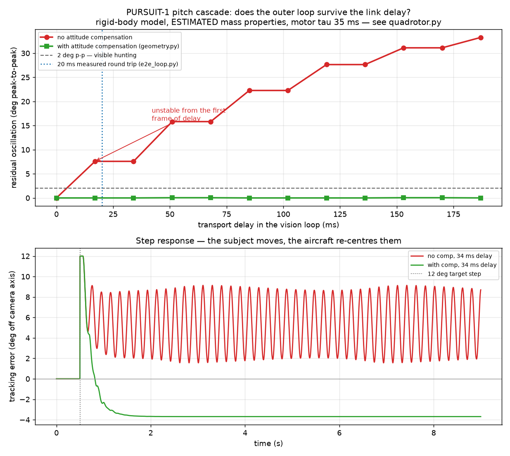

# Closed-loop flight simulation

```bash
python sim/flight/lag_sweep.py              # the sweep, the table, the plot
python sim/flight/lag_sweep.py --trace 34   # one delay, both arms
python sim/flight/lag_sweep.py --tau-motor 25   # sensitivity to the worst-known number
```

## Why this exists

Every gain in this project was a guess. `ANGLE_KP = 6.0f` in `main.cpp` and the
rate gains in `pid.cpp` are scaled from typical brushed-whoop values and have
never touched this airframe. `vision/sim_drone.py` could not help — it is a
*link* simulator and says so; its altitude "dynamics" are a first-order lag
toward the setpoint, a plant that is stable by construction and therefore
incapable of telling you whether yours is.

So the first question anyone asks about a control system — how do you know it
is stable? — had the honest answer "I don't."

This is the smallest model that can answer it: rigid-body rotational dynamics,
first-order motor lag, quadratic thrust, saturation, and the real three-loop
cascade with the real gains.

## The result

The outer vision loop is closed **through the airframe**. Pitching to chase a
subject moves the camera, which moves where that subject appears in frame. The
gain of that path is

```
VIS_PITCH_KP / VFOV_HALF_DEG  =  34 deg per unit error / 26 deg per half-frame  =  1.31
```

Above unity. Correcting a subject who is 12 degrees high commands 15.7 degrees
of pitch, which moves them *further* than the error that prompted it. Add any
delay and it oscillates.

| transport delay | no attitude compensation | with compensation |
|---|---|---|
| 0 ms | settled | settled |
| 17 ms (1 frame) | **7.6 deg p-p, growing** | settled |
| 51 ms (2 frames) | **15.8 deg p-p** | settled |
| 102 ms (3 frames) | **22.3 deg p-p** | settled |
| 187 ms (6 frames) | **33.3 deg p-p** | settled |
| boundary | **~17 ms — the first frame** | **> 200 ms** |

The measured round trip is about 20 ms on the loopback harness
(`vision/tools/e2e_loop.py`). Uncompensated, that is already past the boundary.



**This quantifies a change that had previously only been argued for.** The
attitude compensation in `vision/pursuit/geometry.py` was added because the
coupling was reasoned about and the sign worked out on paper. It now has a
number attached: it converts a loop that oscillates at the first frame of delay
into one with more than an order of magnitude of margin.

## What this does not establish

Stated plainly, because a simulation that oversells itself is worse than none:

- **The mass properties are estimates.** 66 g all-up and the inertias come from
  the README's budget and a plate-plus-point-masses calculation, not a scale
  and not a bifilar pendulum. Inertia enters the inner-loop gain linearly.
- **`tau_motor_s = 35 ms` is a literature value**, not measured on these
  motors, and it is the number the answer is most sensitive to. Measure it
  first: step one motor from the bench console and read the blackbox. Run
  `--tau-motor 25` and `--tau-motor 45` to see how much it moves.
- **The subject is stationary once it steps.** With perfect compensation that
  fully opens the feedback path, so the "> 200 ms" margin is optimistic.
  Against a continuously moving subject the loop closes through the tracker
  and the real margin will be smaller. This is the most important caveat here.
- **No aerodynamics.** No drag, no ground effect, no prop wash, no wind, no
  battery sag. Sag in particular will reduce authority exactly when the loop is
  working hardest.
- **The cascade in `cascade.py` is a PORT, not the firmware.** Retuning
  `pid.cpp` does not update it. This is the same duplication the wire protocol
  deliberately avoids by generating one side from the other, and no equivalent
  guard exists here — `test_cascade.py` pins the values so drift is at least
  loud rather than silent.

Treat the boundary as an order of magnitude with a named sensitivity, not a
specification. What survives all of the above is the *shape*: the uncompensated
loop is unstable at any realistic link delay, and the compensation is what
makes the design work.

## Files

| file | what it is |
|---|---|
| `quadrotor.py` | 6-DOF rigid body, motor lag, quadratic thrust, saturation |
| `cascade.py` | numpy port of the angle P + rate PID + mixer + vision PD |
| `lag_sweep.py` | the experiment, the table, the plot |
| `test_cascade.py` | pins the ported gains and the analytic steady state |
